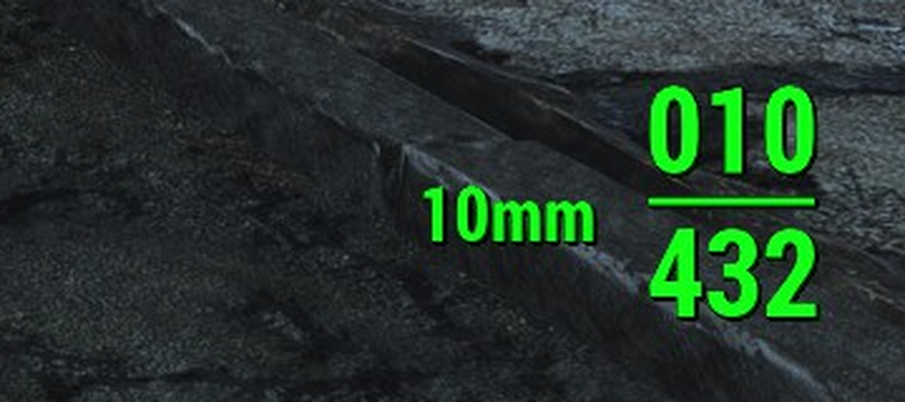

# Ammo Type on HUD

[Nexus Mods page](https://www.nexusmods.com/fallout4/mods/110793) · F4SE plugin for **Fallout 4 1.11.240** that shows the ammo type of the equipped weapon next to the vanilla
HUD ammo counter, in the HUD's own font and colour. No ESP/ESL, nothing stored in saves.



## How it works

- A `TextField` is added inside `RightMeters_mc.AmmoCount_mc` of `Interface\HUDMenu.swf`, to the left of
  `ClipCount_tf` / `ReserveCount_tf`, copying their text format. It inherits the HUD colour and is hidden with
  the counter.
- Every 250 ms a UI task reads `Actor::GetCurrentAmmo` for the player and updates the text when it changes.
- `AmmoTypeHUD.ini` (size, position, width, words stripped from ammo names) is reloaded when it changes.
- Log: `Documents\My Games\Fallout4\F4SE\AmmoTypeHUD.log`.

## Building

Requirements: Visual Studio 2022 (or Build Tools) with C++, and [xmake](https://xmake.io).

```bat
git clone --recurse-submodules <this repository>
cd ammo-type-hud
xmake f -y -m releasedbg
xmake build -y
```

Output: `build\windows\x64\releasedbg\AmmoTypeHUD.dll`. Ship it with `AmmoTypeHUD.ini` in `Data\F4SE\Plugins\`.

## License

GPL-3.0 with the exceptions in `EXCEPTIONS`, as CommonLibF4 and the
[libxse plugin template](https://github.com/libxse/commonlibf4-template) it is based on.

Written with the help of an AI assistant (Claude), built and tested in game by jnappo.
